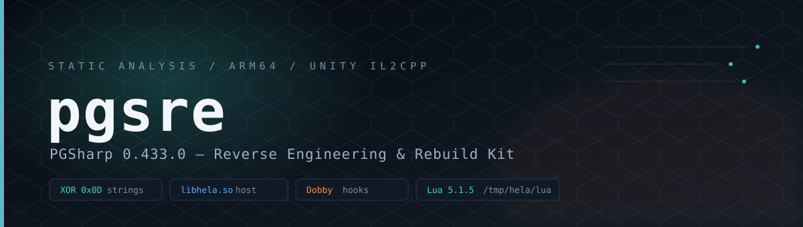
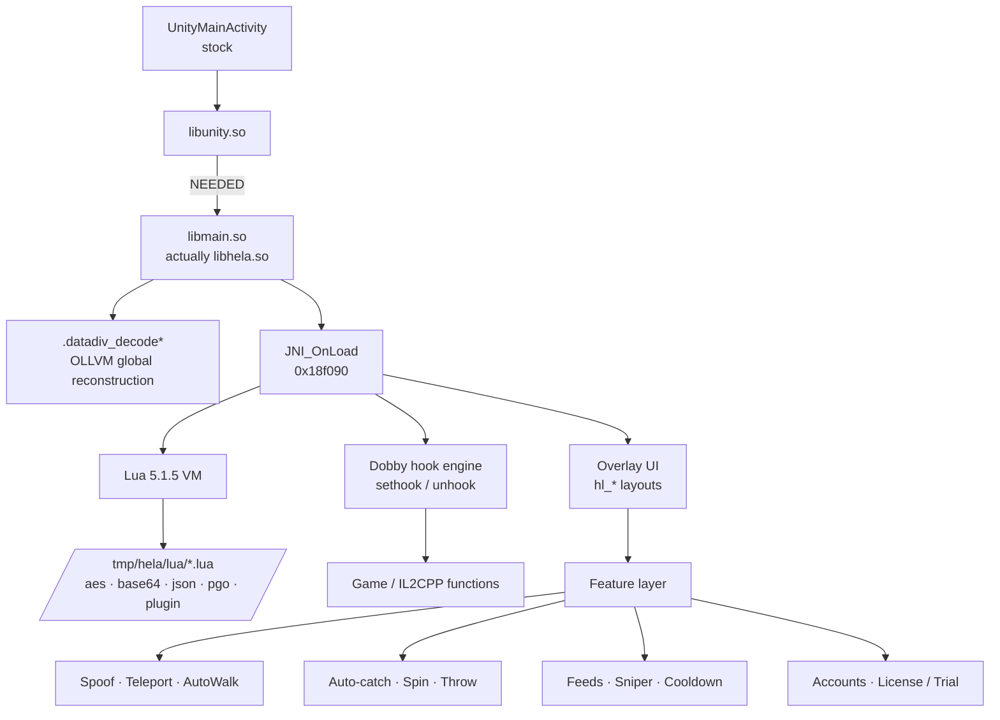
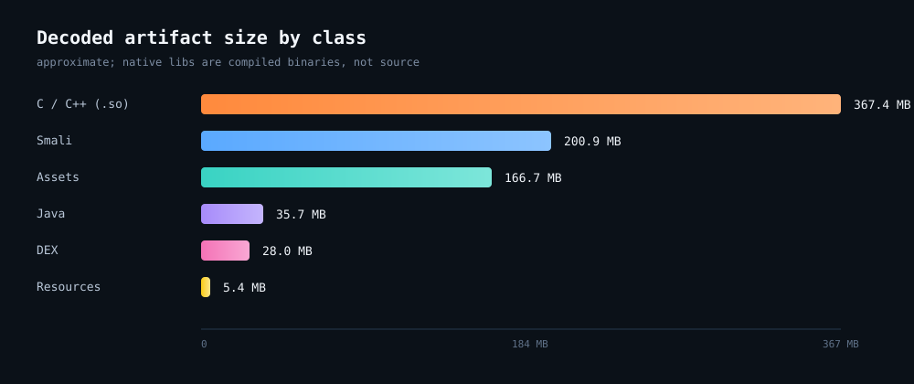

<div align="center">



# pgsre

### PGSharp 0.433.0 — Reverse Engineering & Rebuild Kit

**Static analysis · string decryption · native hook map · rebuild pipeline**


</div>

---

> [!WARNING]
> **Research and documentation only.** This repository does **not** ship the APK, decompiled game code, native libraries, or copyrighted game assets. It documents the reverse-engineering process and provides tooling to reproduce a decoded tree locally from an APK you are entitled to use. Modified clients violate Niantic's Terms of Service and carry a real ban risk. No license, activation, or DRM bypass is included.

---

## Overview

`pgsre` is a complete static reverse-engineering study of a **PGSharp-modified Pokémon GO 0.433.0** client. The analysis establishes what the package is, how the modification is loaded, how its strings are encrypted, what the mod actually does, and how the APK can be decoded, rebuilt, and re-signed.

The sample is **not** an official Niantic build. The game DEX is effectively stock; the modification lives in a replaced Unity player library:

| Property | Value |
|---|---|
| Package | `com.nianticlabs.pokemongo` |
| Version | `0.433.0` (`2026100702`) |
| Engine | Unity · IL2CPP metadata **v39** |
| ABI | `arm64-v8a` only |
| Mod host | `libmain.so` → SONAME **`libhela.so`** |
| Mod host size | 38,312,416 bytes |
| Mod host SHA-256 | `c3f93191436481b347fab8cb33113ea36cbf60744dccb9e99924788d7f403b4b` |
| Signer | self-signed `CN=hela, OU=uw, O=uw, L=uw, ST=uw, C=uw` |
| Signature schemes | APK Signature Scheme **v3** only |
| String cipher | single-byte **XOR `0x0D`** |
| Hook engine | **Dobby** inline hooks |
| Scripting | embedded **Lua 5.1.5** (mislabelled `"Ruby 5.1.5"`) |

---

## Architecture



Full breakdown: [`docs/ARCHITECTURE.md`](docs/ARCHITECTURE.md)

---

## Language & artifact breakdown

The decoded project is roughly **804 MB** across six artifact classes.

| Layer | Language / format | Files | Size | Role |
|---|---|---:|---:|---|
| Native | C / C++ (compiled ARM64) | 28 `.so` | 367.4 MB | engine, game, mod host |
| Bytecode | Smali | 23,365 | 200.9 MB | DEX disassembly (rebuildable) |
| Assets | Unity / binary / JSON | 800+ | 166.7 MB | game data, IL2CPP metadata |
| Java | Java (decompiled) | 8,157 | 35.7 MB | readable DEX source |
| Bytecode | DEX | 3 | 28.0 MB | original classes |
| Resources | XML / PNG | 2,046 | 5.4 MB | manifest, layouts, drawables |



> Native libs are **compiled binaries**, not recoverable C/C++ source. Smali and Java are two views of the same DEX. Assets are counted, not redistributed.

More: [`docs/LANGUAGES.md`](docs/LANGUAGES.md) · [`docs/ASSET-INVENTORY.md`](docs/ASSET-INVENTORY.md)

---

## Recovered feature surface

<details>
<summary><b>Catching, throwing, spinning</b></summary>

| Feature | Evidence |
|---|---|
| Auto-catch | `autocatch`, `Quick Catch`, `hl_catch_caught`, `_escaped`, `_fled`, `_missed` |
| Auto-spin | `autospin`, `hl_aw_station` |
| Throw assist | `enhancedThrowARPlus`, `enhancedThrowCurve`, `enhancedThrowExcellent`, `enhancedThrowHit` |
| Curve / excellent indicators | `hl_curveball`, `hl_excellent`, `hl_enhanced_throw` |
| Auto discard / transfer / feed / hatch | `autoDiscard`, `autoTransfer`, `autoFeed`, `autoHatch` |
| Inventory snapshots | `autoInventorySnapshot`, `autoWildSnapshot` |

</details>

<details>
<summary><b>Spoofing, walking, teleport</b></summary>

| Feature | Evidence |
|---|---|
| Mock location | `Spoofing Location`, `hl_spoofing`, `lua.spoof`, `plg.enablespoof`, `u_enable_spoof` |
| Teleport | `Teleport`, `Tap to Walk/Teleport`, `hl_teleport`, `spoofto`, `hl_mapbox_popup_teleport` |
| AutoWalk | `AutoWalk`, `hl_floatmenu_autowalk`, `hl_aw_day/week/loop/oneway/outandback/poi/gym/station` |
| Speed control | `hl_speed_seek`, `plg.setspeed`, `u_walkspeed` |
| Random walk | `lua.randomwalk`, `plg.randomwalk`, `u_spoof_runnable` |
| Joystick | `JoystickView_JV_*`, `plg.joystart`, `plg.jostop` |
| GPX routes | `Auto-Generated GPX`, `hl_autogenerate_gpx_pat`, `Import GPX Failed` |

</details>

<details>
<summary><b>Feeds, sniper, cooldown</b></summary>

| Feature | Evidence |
|---|---|
| Live feeds | `Feeds`, `hl_feeds_cat_pokemon/quest/raid/misc`, `hl_feed_filter_*` |
| Quick Sniper | `Quick Sniper`, `hl_fastsnipe`, `hl_feeds_item_fastsnipeFlag` |
| Cooldown timer | `Cooldown: %s`, `hl_cooldown_timer`, `MapPokestop_SetCooldownTime` |
| Cooldown history | `Cooldown History`, `hl_cdhist*`, `hl_cdhist_cat_pgslog` |
| Softban warning | `Please RESPECT cooldown rules to avoid softban.`, `_hl_pgp_softban` |

</details>

<details>
<summary><b>Raids, rockets, gifts, accounts</b></summary>

| Feature | Evidence |
|---|---|
| Instant Rocket / Leader | `Instant Beat Team Rocket`, `instantRocket`, `instantLeader` |
| AR mapping | `Instant ArMapping`, `hl_armapping`, `hl_arplus` |
| Gift assistant | `Gift Assistant`, `GiftingRpcService_OpenGift`, `GiftingRpcService_SendGift` |
| Multi-account | `hl_accounts_*`, `hl_account_item_name/lv/p_img` |
| IV / PvP analysis | `hl_ec_pvp_gl/ul/ml`, `hl_eciv`, `hl_ff_attr_iv`, `hl_ffp_checkshiny` |
| Map overlay | `hl_mapbox_popup_*`, `hl_mbmap_*`, `showMapAvatars` |
| Stealth | `Hide PGSharp`, `hideRaidStatus`, `hideTrainerName` |

</details>

<details>
<summary><b>Licensing and activation</b></summary>

| Feature | Evidence |
|---|---|
| Activation | `https://www.pgsharp.com/activation`, `hl_activate_dialog`, `hl_settings_object_activate` |
| Trial limits | `The feed is limited (Trial/Free License).` |
| Tier gating | `Please upgrade to standard license...`, `This feature is not available for %s license.` |
| Export | `Your settings/feeds/favorites/license will be exported to a file...` |
| Update channel | `https://www.pgsharp.com/download64` |

</details>

Full data: [`data/features.json`](data/features.json) · [report](docs/REPORT.md)

---

## String decryption

The mod encrypts strings with **single-byte XOR `0x0D`**. Because `0x20–0x7E` is closed under that XOR, plaintext also survives the transform; a bigram classifier separates real decryptions from scrambled plaintext.

| Ciphertext | Plaintext |
|---|---|
| `-~}hndkdhi` | `" specified"` |
| `)Dc{ladi-YA^-nelccha-DI-fht-~}hndkdhi` | `$Invalid TLS channel ID key specified` |
| `-yelc-laabzhi-ot-yeh-]FNH-~}hndkdnlydbc` | ` than allowed by the PKCE specification` |

```python
KEY = 0x0D
plain = bytes(b ^ KEY for b in cipher)
```

```bash
python3 tools/xor0d_decrypt.py libmain.so libmain_xor0d.bin
strings -n 4 libmain_xor0d.bin
```

Result: **361,187** printable strings; **33,951** genuine decryptions; **1,058** curated mod identifiers.

More: [`docs/DECRYPTION.md`](docs/DECRYPTION.md) · [`tools/xor0d_decrypt.py`](tools/xor0d_decrypt.py)

---

## Lua plugin API

<details>
<summary><b>20 runtime script paths + 21 API symbols</b></summary>

**Scripts** (runtime only — not shipped in the APK):

```
/tmp/hela/lua/{aes,base64,class,fifo,gamedump,global,init,jclass,
               json,localtest,location,md5,pgo,pgodump,plugin,
               reflect,uuid,test_old,templateindexs}.lua
/data/local/tmp/hela/lua/{test,debug}.lua
```

**API:**

```
plg.run          plg.pause        plg.setspeed     plg.map
plg.float        plg.http         plg.joystart     plg.jostop
plg.randomwalk   plg.entergame    plg.enablespoof

pgo.lua          pgo.hook         pgo.il2ready
pgo.statector    pgo.statees      pgo.svcctor

lua.spoof        lua.randomwalk
hela.login       Hela.LoadedPlugin
```

</details>

Data: [`data/lua_api.json`](data/lua_api.json) · [`data/lua_paths.txt`](data/lua_paths.txt)

---

## Rebuild pipeline

> The decoded tree is **not committed** (it contains proprietary content). The scripts recreate it locally.

```bash
# 1. decode an APK you are entitled to use
./tools/decode.sh /path/to/pokemongo.apk

# 2. edit smali / res / manifest as needed

# 3. rebuild, align, sign
./tools/rebuild.sh

# 4. verify
./tools/verify.sh signed.apk
```

Requirements: `apktool` 3.0.3, Android build-tools 34.0.0 (`aapt2`, `zipalign`, `apksigner`), JDK 21, and `jadx` for Java recovery.

More: [`docs/REBUILD.md`](docs/REBUILD.md) · [`SOURCE.md`](SOURCE.md)

---

## Detection & IOCs

<details>
<summary><b>High-signal indicators</b></summary>

| Type | Indicator |
|---|---|
| Certificate | `CN=hela, OU=uw, O=uw, L=uw, ST=uw, C=uw` |
| Cert SHA-256 | `E6:01:D7:E0:38:3F:0C:C1:E0:F0:A4:24:33:94:E4:2C:AF:BA:6E:7C:ED:F1:AF:37:7F:90:52:C3:A0:0A:46:A4` |
| Library | `libmain.so` SONAME `libhela.so` |
| Library SHA-256 | `c3f93191436481b347fab8cb33113ea36cbf60744dccb9e99924788d7f403b4b` |
| Strings | `DobbySymbolResolver`, `sethook`, `unhook`, `Hela.LoadedPlugin` |
| Banner | `LuaVersion: Ruby 5.1.5 … Ruby.org` |
| Paths | `/tmp/hela/lua/`, `/data/local/tmp/hela/lua/debug.lua` |
| URLs | `https://www.pgsharp.com/activation`, `/download64` |
| Resources | `hl_settings_object_activate`, `Hide PGSharp`, `Please RESPECT cooldown rules to avoid softban.` |

</details>

Full list: [`docs/IOC.md`](docs/IOC.md) · [`data/iocs.json`](data/iocs.json)

---

## Repository layout

<details open>
<summary><b>Files</b></summary>

```
pgsre/
├── README.md
├── SOURCE.md                 why the proprietary tree is not committed
├── LICENSE                   MIT (original work only)
├── NOTICE                    trademarks & provenance
├── .gitignore
├── assets/
│   ├── banner.svg
│   └── languages.svg
├── data/
│   ├── hashes.json
│   ├── features.json
│   ├── lua_api.json
│   ├── lua_paths.txt
│   ├── languages.json
│   └── iocs.json
├── docs/
│   ├── REPORT.md             full technical report
│   ├── ARCHITECTURE.md
│   ├── FINDINGS.md
│   ├── DECRYPTION.md
│   ├── LANGUAGES.md
│   ├── ASSET-INVENTORY.md
│   ├── IOC.md
│   ├── REBUILD.md
│   ├── FAQ.md
│   └── LEGAL.md
└── tools/
    ├── xor0d_decrypt.py
    ├── decode.sh
    ├── rebuild.sh
    ├── verify.sh
    └── extract_strings.sh
```

</details>

---

## Methodology

1. Acquire and hash the APK.
2. Decode manifest/resources; inspect package, permissions, components.
3. Extract DEX, native libraries, IL2CPP metadata.
4. Parse ELF: `SONAME`, `NEEDED`, exports, `.init_array`, relocations.
5. Disassemble `JNI_OnLoad` (Capstone, AArch64).
6. Recover strings: test single-byte XOR keys against known plaintext.
7. Decrypt with `0x0D`; classify with English bigram scoring.
8. Mine mod identifiers (`hl_*`, `Pgp*`, `Hela*`, `plg.*`, `pgo.*`, `lua.*`).
9. Correlate with anti-cheat, SDKs, and the game stack.
10. Rebuild with apktool, align, sign, verify.

Tools used: REA v42, JADX 0.7.1, `apktool` 3.0.3, `readelf`, `strings`, `pyelftools`, `capstone` 5.0.7.

---

## FAQ

<details>
<summary><b>Is the full source in this repo?</b></summary>

No. The decoded tree contains proprietary game code and assets. `SOURCE.md` documents how to reproduce it locally. This repository contains only original analysis, tooling, and documentation.
</details>

<details>
<summary><b>Can the mod library be recompiled?</b></summary>

No. `libhela.so` and `libil2cpp.so` are stripped, OLLVM-obfuscated ARM64 binaries. You can repackage them, not rebuild them from source.
</details>

<details>
<summary><b>Why does the rebuild need a new signature?</b></summary>

The original private key is not in the APK — only the certificate. Re-signing changes the certificate; Play Integrity and any certificate-pinned checks will notice.
</details>

<details>
<summary><b>Are the Lua scripts recoverable?</b></summary>

Not statically. No `\x1bLua` bytecode exists in the APK; scripts are referenced at `/tmp/hela/lua/` and loaded at runtime.
</details>

---

## Legal

This project is independent research. It is not affiliated with Niantic, Nintendo, The Pokémon Company, or PGSharp. All trademarks belong to their owners. No proprietary code or assets are distributed. See [`NOTICE`](NOTICE) and [`docs/LEGAL.md`](docs/LEGAL.md).

---

<div align="center">
<sub>Reverse-engineered with static analysis. Built for documentation, detection, and research.</sub>
</div>
